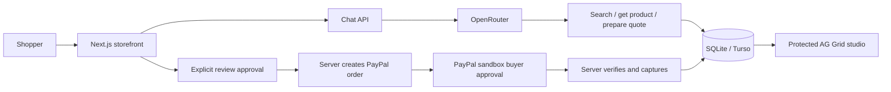

# Architecture

## Trust and payment lifecycle

The browser supplies a product or quote identifier, never an authoritative price. The server looks up the catalog, validates the shopper budget and hard cap, and stores a 15-minute quote. A cryptographically random HTTP-only cookie identifies its owner.

`POST /api/orders` requires the same origin, the owning session, the quote ID, and `approved: true`. It records the shopper's review approval and creates one PayPal order per quote. The PayPal merchant ID is snapshotted from the created order. PayPal REST uses the merchant application's credentials and the sandbox host exclusively.

`POST /api/orders/:id/capture` requires the same owner and recorded approval. It verifies PayPal order amount, currency, and receiving merchant. Only a PayPal `APPROVED` order can be newly captured. A previously completed remote capture is reconciled even if the quote has since expired. Only one completed capture with matching amount is recorded as success. Pending captures remain pending.

Database leases serialize mutations. Stable PayPal request IDs deduplicate retries after a lost response. A unique quote constraint prevents multiple local orders; unique PayPal order and capture constraints prevent duplicate payment records. A lease lasts 90 seconds, longer than the normal external request budget. A crashed process therefore delays a retry rather than creating an uncontrolled retry race.

`GET /api/orders/:id` can reconcile an existing remote capture but never initiates capture. A pending order identifier in local storage is only a recovery hint; it grants no authority without the session cookie.

Commission is integer cents multiplied by the snapshotted basis-point rate, rounded down. It is written only with a completed capture. Alice has 15%; Bob has 10%. Nothing sends a creator payout.

## HTTP interfaces

| Route                          | Behavior                                                                                  |
| ------------------------------ | ----------------------------------------------------------------------------------------- |
| `POST /api/chat`               | Text conversation, shopper budget, optional referral; streams model text and tool results |
| `GET /api/catalog?q=&max=`     | Catalog search; `max` is integer cents                                                    |
| `GET /api/referral?code=`      | Resolve an active creator code                                                            |
| `POST /api/quotes`             | `{ productId, budgetCents, ref? }`; returns a server-priced public quote                  |
| `POST /api/orders`             | `{ quoteId, approved: true }`; returns internal and PayPal order identifiers              |
| `POST /api/orders/:id/capture` | Capture or reconcile an approved owned order                                              |
| `GET /api/orders/:id`          | Read owned receipt and reconcile existing remote capture                                  |
| `POST /api/dashboard/login`    | Exchange merchant passphrase for an expiring signed cookie                                |
| `POST /api/dashboard/logout`   | Delete merchant cookie                                                                    |
| `GET /api/dashboard`           | Authenticated, payer-free order report                                                    |
| `GET /api/health`              | Sanitized configuration/database readiness                                                |

Errors are `{ error, code }` with appropriate status codes. Mutations reject foreign/missing origins, malformed input, and oversized bodies. Payment and chat requests have session/IP limits; chat also has an application-wide daily limit. Hosted IP handling assumes the deployment platform normalizes its forwarding headers. Rate limits are prototype abuse controls, not a replacement for platform traffic protection.

## Data and operations

Drizzle defines the product read model; libSQL handles transactional migration batches and payment state updates. Migration filenames are tracked in a `migrations` table. Use a single migration operator during release. Seed data never overwrites captures or product edits.

No webhook is required for this prototype: pending or interrupted payments are reconciled when the shopper checks status. The merchant should reconcile any unresolved payment through PayPal sandbox before treating it as unpaid. This prototype does not fulfill physical orders or reserve real inventory.

Logs contain event names, order/capture identifiers, and sanitized PayPal error metadata. They exclude access tokens and payer addresses. The browser receives no payment secret, model key, database token, or merchant passphrase.
